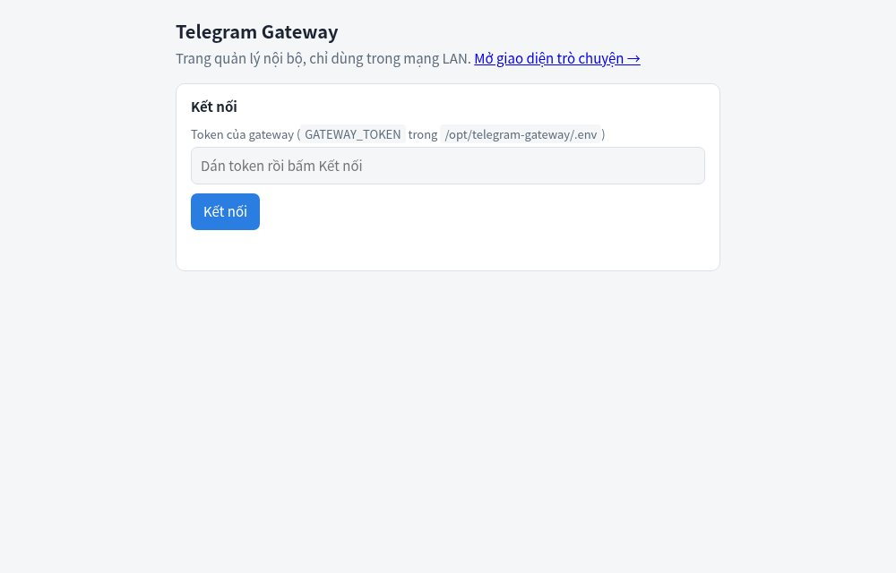

# ✈️ Telegram Calling

Cổng Telegram cho Home Assistant: đăng nhập **tài khoản Telegram phụ**, nhắn tin, gọi
thoại/video, đẩy sự kiện về HA.

> ⚠️ **Dùng tài khoản phụ**, không dùng tài khoản chính. Một tài khoản chỉ đăng nhập ở **một nơi**
> (không chạy cùng lúc ở module web2api `telegram-user`).
> ⚠️ **Bản xem trước (0.x):** gateway chạy và có test; tích hợp HA «Telegram Call» (HACS) đang hoàn thiện, gọi thật chưa kiểm hết.

## Thêm nhanh vào Home Assistant

| Bước | Nút |
|---|---|
| ① Thêm kho add-on | [](https://my.home-assistant.io/redirect/supervisor_add_addon_repository/?repository_url=https%3A%2F%2Fgithub.com%2FTriTue2011%2Fhas-addons) |
| ② Mở tích hợp trong HACS | [](https://my.home-assistant.io/redirect/hacs_repository/?owner=TriTue2011&repository=Telegram-calling&category=integration) |
| ③ Thêm tích hợp (sau khi tải + khởi động lại HA) | [](https://my.home-assistant.io/redirect/config_flow_start/?domain=telegram_call) |

**Làm tay (HACS 2.x):** HACS → **⋮ → Custom repositories** → `https://github.com/TriTue2011/Telegram-calling`, **Type = Integration** → **Add** → **Download** → khởi động lại HA.

## 1. Lấy thông số Telegram (làm một lần)

Cần **`api_id`** và **`api_hash`** — chìa khoá để app của bạn nói chuyện với Telegram.

1. Vào <https://my.telegram.org>, nhập số điện thoại (tài khoản phụ) → nhập mã Telegram gửi về.
2. Chọn **API development tools**.
3. Điền **App title** và **Short name** (tuỳ ý, ví dụ `HA Gateway`), **Platform** chọn *Desktop*, để trống URL → **Create application**.
4. Chép **App api_id** (một số) và **App api_hash** (chuỗi 32 ký tự). **Giữ bí mật `api_hash`.**

## 2. Add-on (HAOS / Supervised)

1. **Cài đặt → Add-on → Cửa hàng → ⋮ → Kho lưu trữ** → `https://github.com/TriTue2011/has-addons` → cài **Telegram Calling**.
2. Tab **Cấu hình**:

   | Tuỳ chọn | Điền gì |
   |---|---|
   | `api_id` | Số **App api_id** ở bước 1 |
   | `api_hash` | Chuỗi **App api_hash** ở bước 1 |
   | `gateway_token` | **Bỏ trống** = tự sinh, in ra tab **Nhật ký** |
   | `ha_webhook_url` | Tuỳ chọn, bỏ trống cũng được |

3. **Khởi động**. Nhật ký in `token cho tích hợp Telegram Call = …` — chép token này.
4. **Mở WebUI** (`http://<IP HA>:3333/ui/`), dán token → **Kết nối**, rồi **thêm tài khoản**:
   số điện thoại → mã OTP (→ mật khẩu 2 lớp nếu có), hoặc quét QR.



> Chưa điền `api_id`/`api_hash` thì Nhật ký báo gateway đang chạy **giả lập** (chưa đăng nhập thật được).

## 3. Docker

Tạo thư mục `telegram-calling/` với hai tệp:

**`docker-compose.yml`**

```yaml
services:
  telegram-calling:
    image: ghcr.io/tritue2011/telegram-calling:latest
    container_name: telegram-calling
    restart: unless-stopped
    ports:
      - "127.0.0.1:3333:3333"   # HA ở máy khác: "IP_LAN_CỦA_MÁY:3333:3333" + firewall chỉ cho IP của HA
    volumes:
      - ./data:/data            # phiên Telegram nằm ở đây, giữ kín
    environment:
      GATEWAY_TOKEN: ${GATEWAY_TOKEN}
      TELEGRAM_API_ID: ${TELEGRAM_API_ID}
      TELEGRAM_API_HASH: ${TELEGRAM_API_HASH}
      GATEWAY_MOCK: "0"         # 0 = chạy thật; bỏ dòng này (hoặc để 1) = giả lập
```

**`.env`** (`chmod 600 .env`)

```
# sinh bằng: openssl rand -hex 32
GATEWAY_TOKEN=
# số App api_id ở bước 1
TELEGRAM_API_ID=
# chuỗi App api_hash ở bước 1
TELEGRAM_API_HASH=
```

```sh
docker compose up -d                          # chạy
docker compose logs -f                        # xem nhật ký
docker compose pull && docker compose up -d   # cập nhật
```

Mở `http://<máy>:3333/ui/`, dán `GATEWAY_TOKEN`, thêm tài khoản như bước 2.4.
Ghim phiên bản: đổi `:latest` thành `:0.2.1`. Tên biến ↔ add-on: `TELEGRAM_API_ID` = `api_id`, `TELEGRAM_API_HASH` = `api_hash`, `GATEWAY_TOKEN` = `gateway_token` (ở Docker là **bắt buộc**; add-on tự sinh nếu bỏ trống).

## Cần biết

- Cổng **3333 chỉ để trong LAN** (có token), đừng mở ra Internet. Bản sao lưu HA chứa **phiên Telegram** — giữ kín.
- Mất khoá dữ liệu = phải đăng nhập lại. Flood-wait của Telegram được tôn trọng (đợi theo số giây Telegram báo).
- Chi tiết kỹ thuật (REST, sự kiện): <https://github.com/TriTue2011/Telegram-calling>
