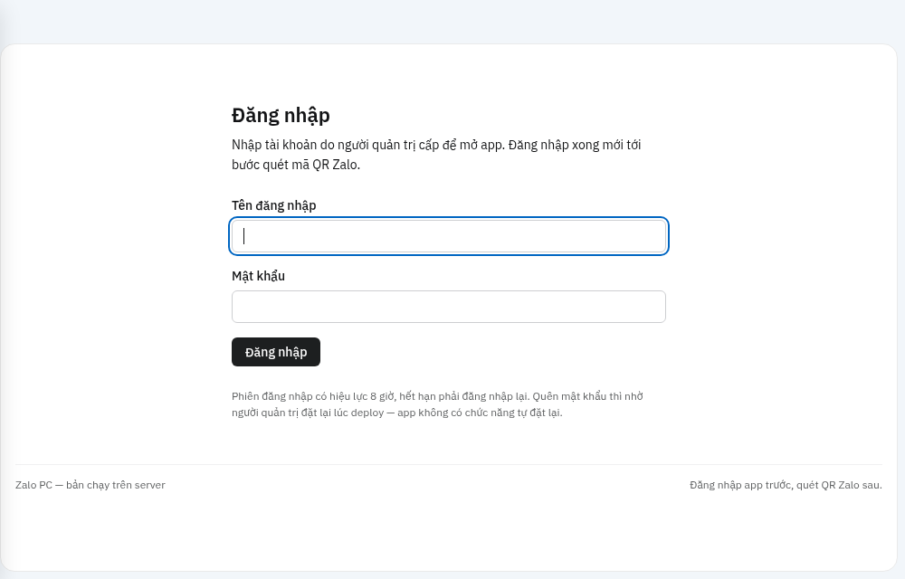

# 📞 Zalo Calling

Gọi **thoại và video Zalo** từ Home Assistant: điện thoại đổ chuông, nghe máy xong tiếng
bên kia ra **loa trong nhà** (R1, loa camera, `media_player`), mic loa/camera gửi sang
điện thoại, video phát hình từ **camera nhà**.

> ⚠️ App không chính thức, đăng nhập Zalo bằng mã QR. **Dùng tài khoản Zalo phụ.**

**Cần 2 phần:** ① **add-on này** (app đăng nhập Zalo) + ② **tích hợp Zalo Call** (HACS).

## Thêm nhanh vào Home Assistant

| Bước | Nút |
|---|---|
| ① Thêm kho add-on | [](https://my.home-assistant.io/redirect/supervisor_add_addon_repository/?repository_url=https%3A%2F%2Fgithub.com%2FTriTue2011%2Fhas-addons) |
| ② Mở tích hợp trong HACS | [](https://my.home-assistant.io/redirect/hacs_repository/?owner=TriTue2011&repository=Zalo-calling&category=integration) |
| ③ Thêm tích hợp (sau khi tải + khởi động lại HA) | [](https://my.home-assistant.io/redirect/config_flow_start/?domain=zalo_call) |

Thiếu một phần là không chạy. Add-on chỉ có trên **HAOS / Supervised**; HA Docker xem [mục Docker](#docker).

## ① Cài add-on

1. **Cài đặt → Add-on → Cửa hàng → ⋮ → Kho lưu trữ** → dán `https://github.com/TriTue2011/has-addons`.
2. Cài **Zalo Calling**. Tab **Cấu hình**:

   | Tuỳ chọn | Ý nghĩa |
   |---|---|
   | `username` | Tên đăng nhập WebUI (mặc định `admin`) |
   | `password` | Mật khẩu WebUI. **Bỏ trống** = tự sinh, in ra tab **Nhật ký** |

3. **Khởi động**, đọc **Nhật ký** lấy mật khẩu, bấm **Mở WebUI** (`http://<IP HA>:8080`).
4. Đăng nhập, rồi **quét mã QR** bằng Zalo trên điện thoại (tài khoản phụ). Thấy danh bạ là xong.



## ② Cài tích hợp (HACS)

1. HACS → **⋮ → Custom repositories** → `https://github.com/TriTue2011/Zalo-calling`, **Type = Integration** → **Add** → tìm **Zalo Call** → **Download** → khởi động lại HA.
2. **Thêm tích hợp → Zalo Call**: địa chỉ app `http://<IP HA>:8080` + tài khoản WebUI ở trên.
3. Trên thiết bị **Zalo Call**: điền **Địa chỉ HA** (`http://<IP HA>:8123`), chọn **Loa / Mic / Camera mặc định**
   (có mục *Hình kiểm tra* để thử), đặt **Âm lượng cuộc gọi** (0 = giữ nguyên) và **Chống vọng**.

## Gọi

WebUI → chọn người trong danh bạ → **Gọi** / **Video**. Hoặc từ automation:

```yaml
service: zalo_call.make_call
data: {thread_id: "123456789012345678", type: video, volume: 70}   # thread_id xem ở mục Cuộc gọi của WebUI
```

Sự kiện `zalo_call_call_state` (`incoming`, `ringing`, `answered`, `declined`, `no_answer`, `ended`…) dùng cho automation.
Service khác: `answer_call`, `reject_call`, `end_call`, `upgrade_to_video`, `set_default_devices`.

## Docker

Cho HA Container hoặc khi chạy app ở máy khác. Tạo thư mục `zalo/` với hai tệp:

**`docker-compose.yml`**

```yaml
services:
  zalo-calling:
    image: ghcr.io/tritue2011/zalo-calling:latest
    container_name: zalo-calling
    restart: unless-stopped
    init: true                # dọn ffmpeg mồ côi, không để lại tiến trình ma
    mem_limit: 512m           # đo: ~70 MB lúc rảnh, mỗi ffmpeg video ≤ ~160 MB; tăng nếu camera 4K
    memswap_limit: 512m       # không tràn sang swap
    cpus: "1.5"
    pids_limit: 256
    logging:
      driver: json-file
      options: {max-size: "10m", max-file: "3"}
    ports:
      - "8080:8080"      # HA cùng máy và dùng network host: đổi thành "127.0.0.1:8080:8080"
    volumes:
      - zalo-data:/data  # phiên đăng nhập Zalo nằm ở đây
    environment:
      ZALO_PC_APP_USER: ${ZALO_PC_APP_USER}
      ZALO_PC_APP_PASSWORD: ${ZALO_PC_APP_PASSWORD}
volumes:
  zalo-data:
```

**`.env`** (cùng thư mục; mật khẩu dài, không ghi vào compose)

```
ZALO_PC_APP_USER=admin
ZALO_PC_APP_PASSWORD=mat-khau-dai
```

```sh
docker compose up -d                          # chạy
docker compose logs -f                        # xem nhật ký
docker compose pull && docker compose up -d   # cập nhật
```

Mở `http://<máy>:8080`, đăng nhập, quét QR. Bước ② y hệt, địa chỉ app là `http://<IP máy Docker>:8080`.
Ghim phiên bản: đổi `:latest` thành `:2026.11.10.20`. Tên biến ↔ add-on: `ZALO_PC_APP_USER` = `username`, `ZALO_PC_APP_PASSWORD` = `password` (ở Docker là **bắt buộc**).

## Lỗi thường gặp

| Lỗi | Cách xử |
|---|---|
| Tích hợp báo «Không gọi được tới app» | Add-on chưa chạy, hoặc sai cổng 8080 |
| Video không có hình / nháy rồi mất | Đặt lại **Camera mặc định** (hoặc chọn *Hình kiểm tra* để thử) |
| Loa nhỏ | Tăng **Âm lượng cuộc gọi** |
| Tiếng bạn đứt khi nói chồng (loa R1) | R1 là nửa song công; muốn mic luôn mở: **Chống vọng = Song công**, R1 đặt **Động cơ xử lý âm thanh = nâng cao** |
| Tiếng không ra loa R1 | Tải lại tích hợp R1 |

## Cách dùng các dịch vụ

Mở **Công cụ nhà phát triển → Hành động**, gõ `zalo_call.` để chọn dịch vụ (mỗi trường có ô chọn). Người nhận là `thread_id` + `type` (`user` = 1-1, `group` = nhóm).
Lấy `thread_id`: dịch vụ `get_all_friends` / `get_all_groups` (kết quả trả về cho automation), hoặc mở WebUI của app → danh bạ.

### Gọi đi

```yaml
service: zalo_call.make_call
data:
  thread_id: "6643404425553198601"
  type: video                          # user = thoại 1-1 · video = video 1-1 · group = nhóm
  volume: 70                           # tuỳ chọn, 0-100: âm lượng loa lúc gọi, hết cuộc tự trả lại mức cũ
  speaker: media_player.loa_phong_khach   # tuỳ chọn; bỏ trống = loa mặc định đặt bằng dịch vụ `set_default_devices`
  mic: camera.phong_khach              # tuỳ chọn: tiếng từ camera hoặc loa R1 (Assist satellite) gửi sang điện thoại
  camera: camera.phong_khach           # tuỳ chọn (cuộc gọi video): hình gửi đi; bỏ trống = «Camera mặc định»
```

Điện thoại đổ chuông; nghe máy xong tiếng bên kia ra loa, mic loa/camera gửi sang họ. Kết thúc: `zalo_call.end_call` (cũng dùng để huỷ khi còn đổ chuông).
Đang gọi thoại muốn lên video: `zalo_call.upgrade_to_video` (xin bên kia, rồi phát camera đã chọn).

### Nhận cuộc gọi

Có người gọi tới tài khoản Zalo → HA bắn sự kiện **`zalo_call_call_state`** (cũng là cảm biến *Cuộc gọi* trên thiết bị). Trường `state`:
`incoming` (đang đổ chuông) · `ringing` (mình gọi, bên kia đang đổ chuông) · `answered` (đã nối) · `declined` · `no_answer` · `missed` · `rejected` · `ended` · `error`;
kèm `call_id`, `thread_id`, `peer`, `call_type`, `end_reason`. Nghe/từ chối bằng `zalo_call.answer_call` / `zalo_call.reject_call` (bỏ `call_id` nếu chỉ có một cuộc).

```yaml
automation:
  - alias: Zalo gọi đến → báo điện thoại, tự nghe sau 10 giây
    triggers:
      - trigger: event
        event_type: zalo_call_call_state
        event_data: {state: incoming}
    actions:
      - action: notify.mobile_app_dien_thoai
        data: {message: "Zalo gọi đến từ {{ trigger.event.data.peer }}"}
      - delay: 10
      - action: zalo_call.answer_call
        data: {volume: 60}
```

Loa/mic/camera mặc định và các tuỳ chọn đi kèm đặt bằng dịch vụ **`zalo_call.set_default_devices`** (`speaker`, `mic`, `mic_url`, `camera`, `call_volume`, `auto_mic` = tự phát mic khi nghe máy, `auto_video` / `auto_video_delay` = tự đồng ý khi bên kia xin gọi video, `echo_guard` = chống vọng; nếu loa R1 bị nhại tiếng: đặt `duplex` và R1 chọn engine **nâng cao**). Xem lại bằng `get_default_devices`.

### Tin nhắn, tệp, ghi âm

| Việc | Dịch vụ | Ví dụ |
|---|---|---|
| Gửi chữ | `send_message` | `message: "Xin chào"` (định dạng/màu/emoji: mục dưới) |
| Gửi ảnh / tệp / video | `send_image` · `send_file` · `send_video` | `file: /config/www/anh.jpg` (đường dẫn trong thư mục cho phép, hoặc URL) |
| Gửi **tin thoại** | `send_voice` | `file: /config/www/loi-chao.mp3` (mp3/m4a/wav, tự đổi sang AAC); phản hồi có `voice_url` |
| Gửi liên kết có xem trước | `send_link` | `link: https://...`, `message: "xem nè"` |
| Sticker theo từ khoá | `send_sticker` | `keyword: "cảm ơn"`, `pick: random` |
| Thả cảm xúc / trả lời / thu hồi | `add_reaction` · `quote_message` · `undo_message` | `icon: heart` (bảng 54 biểu tượng), `msg_id`, `cli_msg_id` |
| Dịch bằng Zalo AI | `translate_message` | `msgId`, `threadId`, `srcLang: vi`, `desLang: en`, `text` (thử thật với `en`, `ko`) |
| Giọng nói → chữ (STT) | `voice_to_text` | `voiceUrl:` đường dẫn tin thoại **nhận từ người khác**; kết quả ở sự kiện `zalo_call_voice_to_text` (`req_id`, `text`) |
| Đọc nhóm | `get_group_chat_history`, `get_all_groups` | trả dữ liệu cho automation (`response_variable`) |

`msg_id` / `cli_msg_id` lấy từ phản hồi lúc gửi hoặc từ sự kiện **`zalo_call_message`** (tin đến: `content`, `thread_id`, `thread_type`, `is_self`…).

**Gửi tin có TTS của HA thành tin thoại:** tạo tệp âm thanh bằng `tts.speak`/`tts.google_translate_say` ra `/config/www/`, rồi `zalo_call.send_voice` với `file:` trỏ tới tệp đó.

## Định dạng chữ: cỡ chữ, màu, đậm, nghiêng, gạch chân, tiêu đề

Zalo cá nhân có **hai cỡ chữ** (nhỏ, to), **bốn màu** (đỏ, cam, vàng, xanh lá), đậm, nghiêng, gạch chân, gạch ngang và danh sách. Zalo Call cho cài đặt kiểu chữ **một lần trên thiết bị**
(áp cho mọi tin tích hợp gửi, kể cả trả lời của AI) và **ghi đè từng tin** ở dịch vụ `send_message`. Mỗi mục có thêm chế độ **`auto`**: tự định dạng theo nội dung chữ.

### Cài đặt mặc định (thiết bị Zalo Call → nhóm *Cấu hình*)

| Ô trên thiết bị | Giá trị | Ý nghĩa |
|---|---|---|
| **Chữ: cỡ chữ** | `off` · `small` · `big` · `auto` | `small`/`big`: cả tin nhỏ/to. `auto`: tiêu đề to, dòng nằm trọn trong ngoặc `(…)` nhỏ |
| **Chữ: màu chữ** | `off` · `auto` · `red` · `orange` · `yellow` · `green` | Màu cố định cho cả tin. `auto`: chỉ **con số** (29°C, 75%, 15:30, 10/11) được tô màu «màu dùng cho chế độ auto» |
| **Chữ: in đậm** | `off` · `on` · `auto` | `on`: cả tin. `auto`: con số |
| **Chữ: in nghiêng** | `off` · `on` · `auto` | `on`: cả tin. `auto`: đoạn trong `"…"` `“…”` `‘…’` hoặc `(…)` |
| **Chữ: gạch chân** | `off` · `on` · `auto` | `on`: cả tin. `auto`: liên kết `http(s)://…` và địa chỉ email |
| **Chữ: tiêu đề dòng đầu** | `off` · `on` · `auto` | `on`: dòng đầu thành **to + đậm**. `auto`: chỉ khi tin có nhiều dòng, dòng đầu ≤ 60 ký tự và **không** kết thúc bằng dấu câu (`. ! ? … , ;`); dòng ngắn kết thúc bằng `:` thành đề mục (đậm) |
| **Chữ: màu dùng cho chế độ auto** | `red` · `orange` · `yellow` · `green` | Màu của «màu chữ = auto» (mặc định `red`) |
| **Chữ: AI trả lời tự định dạng trong cùng lượt** | công tắc (mặc định **bật**) | Mức 1 bên dưới: AI tự định dạng khi trả lời, không chậm thêm |
| **Chữ: dùng AI đánh giá khi gửi send_message** | công tắc (mặc định tắt) | Mức 3 bên dưới: nhờ trợ lý đánh giá ngữ cảnh cho các mục `auto` (thêm vài giây) |
| **Chữ: trợ lý AI dùng cho chế độ auto** | chọn trợ lý hội thoại | Nên chọn trợ lý nhỏ/nhanh; Không = trợ lý của AI trả lời |
| **Chữ: tự thêm emoji (auto)** | công tắc **bật / tắt** | Bật: mọi tin tích hợp gửi tự có một emoji hợp ngữ cảnh ở đầu từng dòng chưa có emoji (xem mục Emoji). Mặc định tắt |

Mặc định mọi mục là `off` (tin gửi đi như cũ). Quy tắc `auto` dựa trên **hình dạng** của chữ (số, dấu ngoặc, liên kết, dấu câu), không dựa danh sách từ khoá.

### `auto` hoạt động thế nào: nhanh hay theo ngữ cảnh

Mục đích của `auto` là **tự đánh giá ngữ cảnh** để chọn màu, cỡ chữ, đậm/nghiêng, tiêu đề và emoji cho hợp. Có ba mức, **mặc định không làm chậm tin nhắn**:

| Mức | Khi nào | Tốc độ |
|---|---|---|
| **1. AI tự định dạng trong cùng lượt** | Câu trả lời của **AI tự trả lời** (mặc định bật, công tắc *Chữ: AI trả lời tự định dạng trong cùng lượt*): tích hợp nhúng một chỉ dẫn ngắn vào chính câu hỏi gửi trợ lý, trợ lý vừa trả lời vừa tự chọn đậm, màu, tiêu đề, emoji theo nội dung | **Không chậm thêm** (cùng một lần gọi) |
| **2. Quy tắc tức thì** | Mọi tin còn lại, và khi trợ lý quên định dạng: `auto` dùng quy tắc theo hình dạng chữ ở bảng trên (số, ngoặc, liên kết, dấu câu) | **Tức thì** |
| **3. Nhờ AI đánh giá riêng** (tuỳ chọn) | `send_message` có mục `auto` hoặc `auto_emoji`, và bật công tắc *Chữ: dùng AI đánh giá khi gửi send_message* hoặc `ai_style: true` | **Thêm vài giây** (một lần gọi trợ lý; quá 8 giây thì bỏ, dùng mức 2). Tin dưới 24 ký tự bỏ qua |

Mức 3: trợ lý hội thoại của HA đọc tin rồi đánh dấu định dạng + emoji theo ngữ cảnh (cảnh báo → đỏ, thành công → xanh lá, đề mục, nhấn mạnh…).
**Có kiểm soát:** trợ lý chỉ được chèn định dạng và emoji; app **chỉ nhận khi chữ gốc không bị đổi** (thêm/bớt/sửa một chữ là bỏ cả đánh dấu của AI và dùng mức 2). Lỗi hoặc quá giờ cũng quay về mức 2, tin vẫn gửi bình thường.
Muốn nhanh hơn nữa: chọn ở ô *Chữ: trợ lý AI dùng cho chế độ auto* một trợ lý **nhỏ/nhanh** (Không = dùng trợ lý của AI trả lời, rồi trợ lý mặc định của HA). Mức 3 tốn thêm token của trợ lý.

Các mục để giá trị cố định (`on`, `small`, `big`, một màu cụ thể…) luôn được áp chắc chắn, không qua AI. Công tắc **Chữ: tự thêm emoji** cũng theo ba mức trên:
bật cho câu trả lời của AI thì AI tự chọn emoji; tin do người dùng **tự gắn emoji** rồi gửi thì giữ nguyên, các dòng đã có emoji không bị thêm nữa.

### Ghi đè từng tin: `zalo_call.send_message`

Các trường tương ứng (đều tuỳ chọn; **bỏ trống = theo mặc định trên thiết bị**, có điền = ghi đè cho tin này):

| Trường dịch vụ | Tương ứng ô thiết bị |
|---|---|
| `font_size` | cỡ chữ |
| `text_color` | màu chữ |
| `bold` · `italic` · `underline` · `heading` | in đậm · nghiêng · gạch chân · tiêu đề |
| `auto_emoji` | công tắc tự thêm emoji (`true` / `false`) |
| `ai_style` | `true` / `false`: nhờ AI đánh giá ngữ cảnh cho tin này (mức 3) hay dùng quy tắc tức thì; bỏ trống = theo công tắc |
| `auto_color` | màu dùng cho chế độ auto |

```yaml
# Mặc định trên thiết bị: tiêu đề = auto, màu chữ = auto. Tin này thêm: số in đậm, không tô màu.
service: zalo_call.send_message
data:
  thread_id: "6643404425553198601"
  type: user
  message: |
    Báo cáo nhà hôm nay
    Nhiệt độ 29°C, độ ẩm 75% lúc 15:30
    Chi tiết: https://example.com
  bold: auto            # con số in đậm
  text_color: off       # ghi đè «màu chữ = auto» của thiết bị, tin này không tô màu
```

Kết quả: dòng đầu **to + đậm** (tiêu đề auto), `29°C`, `75%`, `15:30` in đậm, liên kết giữ nguyên.

### Thứ tự ưu tiên

1. **Đánh dấu tường minh trong chữ** (markdown, thẻ màu) luôn thắng: cỡ và màu mặc định/auto **không đè** lên chỗ đã có cỡ hoặc màu.
2. **Trường của dịch vụ** `send_message` ghi đè **cài đặt mặc định** trên thiết bị.
3. **Cài đặt mặc định** trên thiết bị (áp cả cho trả lời của AI tự trả lời).

### Đánh dấu tay trong chữ (`format: markdown`)

| Viết | Ra |
|---|---|
| `**đậm**` · `*nghiêng*` · `__gạch chân__` · `~~gạch ngang~~` | đậm · nghiêng · gạch chân · gạch ngang |
| `# Tiêu đề` | to + đậm |
| `- mục` · `1. mục` | danh sách chấm · đánh số |
| `{red}đỏ{/}` `{orange}` `{yellow}` `{green}` (hoặc `{đỏ}` `{cam}` `{vàng}` `{xanh}`) | màu |
| `{big}to{/}` · `{small}nhỏ{/}` | cỡ chữ (chỉ hai cỡ) |
| `\*` | ký tự `*` nguyên văn |

Có thể kết hợp với `auto_emphasis` (tự tô số và chữ đậm), `emoji`, `zalo_emoji`, `auto_emoji`: xem mục tiếp.

### Emoji

| Trường | Làm gì |
|---|---|
| `emoji` | Chọn trong bảng 35 biểu tượng hoặc gõ emoji bất kỳ: chèn vào đầu tin. Mã `:ok:` `:canhbao:`… trong chữ cũng đổi thành emoji |
| `zalo_emoji` | Emoji **của Zalo** (heart, haha, wow, cry…): chèn mã (`/-heart`, `:>`…) vào đầu tin, Zalo hiện thành ảnh emoji như trong bảng emoji của ô chat |
| `auto_emoji` | `true` / `false`: bật / tắt tự thêm emoji **cho tin này**, ghi đè công tắc *Chữ: tự thêm emoji* trên thiết bị (bỏ trống = theo công tắc). Mỗi dòng chưa có emoji được thêm một emoji hợp ngữ cảnh (cảnh báo, lỗi, xong, nhiệt độ, cửa, đèn…); bảng nhỏ, bảo thủ |
| `auto_emphasis` | `red`/`orange`/`yellow`/`green` hoặc `true`: tô màu + in đậm con số và chữ đã in đậm (gần giống «màu chữ = auto» kèm «in đậm = auto», nhưng chọn được màu ngay ở đây) |

Sticker: `zalo_call.send_sticker` với `keyword: "cảm ơn"` (và `pick: random`) tự tìm rồi gửi. Thả cảm xúc lên một tin: `zalo_call.add_reaction` với `icon: heart` (bảng 54 biểu tượng).

**Trả lời của AI tự trả lời:** dùng cùng cài đặt mặc định ở trên, cộng thêm ô *AI: định dạng chữ trả lời* (mặc định `markdown`, để dấu `**` của AI thành chữ đậm thật), và *AI: tự nhấn mạnh số…*. Công tắc *Chữ: tự thêm emoji* cũng áp cho trả lời của AI.

## Cuộc gọi đến, tin nhắn và AI: chính sách bằng dịch vụ (riêng tư trước hết)

Mọi cài đặt này đặt bằng **dịch vụ** (gọi từ Công cụ nhà phát triển hoặc automation), không có ô cài đặt. Nguyên tắc:

- **Không có quy tắc = không làm gì.** Cuộc gọi đến chỉ đổ chuông; tin nhắn, tin thoại không đi đâu (không STT, không AI, không trả lời).
- **Quy tắc theo ai:** `thread` (một threadID — người **hoặc nhóm**), `contacts` (mọi người trong danh bạ), `strangers` (người lạ), `groups` (mọi nhóm). Quy tắc theo threadID **thay hẳn** quy tắc nhóm (không trộn từng trường), nên `answer: false` ở một người chặn được quy tắc danh bạ dễ dãi.
- **Không chắc người đó quen hay lạ** (app chưa tải được danh bạ): chỉ quy tắc theo threadID được áp; quy tắc `contacts`/`strangers` bị bỏ qua.
- **Thiết bị nhà tắt mặc định:** cuộc gọi do quy tắc nghe máy **không** nối mic, loa, camera nhà (app nhận «off»), nên người lạ không nghe được phòng nhà. Chỉ nối khi đặt `home_devices: true`.
- **`ai: true` / `reply_ai: true` bắt buộc chọn `pipeline` hoặc `agent`** (không tự dùng pipeline ưu tiên vì nó có quyền thiết bị nhà). Với người lạ nên chọn trợ lý **không có quyền thiết bị**.
- Người gọi cúp trước khi hết thời gian chờ thì không nghe; webhook lặp chỉ nghe một lần.

### Cài đặt của dịch vụ `zalo_call.set_rule`
Trường nào không nêu thì giữ như cũ (quy tắc mới: mặc định tắt hết). Ô nào có danh sách thì HA tự liệt kê để chọn; ô không có thì gõ tay.

| Nhóm | Trường | Ý nghĩa |
|---|---|---|
| Áp cho | `scope` (bắt buộc) | `thread` / `groups` / `contacts` / `strangers` |
| | `thread_id` | ID Zalo của người hoặc nhóm (gõ tay; lấy bằng `list_contacts`), chỉ khi `scope: thread` |
| | `name` | tên ghi chú |
| Nghe máy | `answer` | tự nghe cuộc gọi 1-1 đến |
| | `answer_delay` | chờ bao nhiêu giây rồi nghe (0–120, mặc định 3) |
| | `call_types` | `voice`, `video` hoặc cả hai (nhận video **chưa kiểm** trên cuộc gọi thật) |
| AI trong cuộc gọi | `ai` | AI nghe và trả lời bằng giọng nói sau khi nghe máy |
| | `pipeline` | Assist pipeline (STT, TTS, trợ lý) — **chọn từ danh sách** |
| | `agent` | trợ lý hội thoại riêng thay trợ lý của pipeline — chọn từ danh sách |
| | `greeting`, `handover_rule` | câu chào đầu; điều kiện riêng để AI tự chuyển sang trực tiếp |
| | `trusted` | người tin cậy (AI không bị dặn kiểu «chưa xác thực») |
| Tin nhắn | `reply_ai` | AI trả lời tin chữ (nhóm thì trả lời vào nhóm) |
| | `voice_text` | tin thoại 1-1 → Zalo STT → chữ (bắn sự kiện `zalo_call_voice_text`); `reply_ai` thì AI trả lời bằng tin thoại |
| Thiết bị nhà | `home_devices` | nối thiết bị nhà cho cuộc gọi do quy tắc nghe máy (mặc định **tắt**) |
| | `speaker`, `mic`, `camera` | chọn từ danh sách thiết bị (trống = mặc định của `set_default_devices`) |
| | `mic_url`, `volume`, `echo_guard` | mic từ URL (gõ tay), âm lượng loa %, chống vọng |

Các dịch vụ khác: `remove_rule` (`scope`, `thread_id`), `list_rules`, `list_contacts` (danh bạ để lấy threadID), `get_default_devices`, `set_default_devices` (loa/mic/camera mặc định cho cuộc gọi do **người** nghe: `speaker`, `mic`, `mic_url`, `camera`, `call_volume`, `echo_guard`, `auto_mic`, `auto_video`, `auto_video_delay`), `make_call` / `answer_call` (kèm `message`, `repeat`, `ai`, `pipeline`, `agent`, `hangup_after`, `greeting`, `handover_rule`, `tts_engine`, `language`), `say_in_call`, `take_over_call`.

### Ví dụ automation (chạy khi HA khởi động)
```yaml
alias: Zalo Call — quy tắc
trigger: [{platform: homeassistant, event: start}]
action:
  # 1) Một người cụ thể: nghe sau 5 giây, KHÔNG nối thiết bị nhà, AI lễ tân (trợ lý không có quyền thiết bị)
  - action: zalo_call.set_rule
    data: {scope: thread, thread_id: "6643404425553198601", name: Đại ca, answer: true, answer_delay: 5,
           ai: true, agent: conversation.le_tan, trusted: true, reply_ai: true, voice_text: true}
  # 2) Mọi người trong danh bạ: chỉ nghe thoại, nối loa/mic phòng khách để nói chuyện trực tiếp
  - action: zalo_call.set_rule
    data: {scope: contacts, answer: true, answer_delay: 10, call_types: [voice],
           home_devices: true, speaker: media_player.r1_loa, mic: assist_satellite.r1}
  # 3) Người lạ: không nghe máy; chỉ AI lễ tân trả lời tin nhắn
  - action: zalo_call.set_rule
    data: {scope: strangers, reply_ai: true, agent: conversation.le_tan}
```

### Chuyển sang trực tiếp
Trong cuộc gọi do AI giữ, AI tự chuyển sang trực tiếp khi khẩn cấp / người gọi muốn gặp người nhà / AI không giúp được (kết thúc câu bằng dấu `[[CHUYEN_MAY]]` — không đọc ra — hoặc công cụ «chuyển sang trực tiếp»). Khi đó AI dừng, cuộc gọi **không bị cúp**, HA bắn `zalo_call_ai_handover` (`call_id`, `heard`, `home_devices`); mic nhà chỉ được nối nếu quy tắc có `home_devices: true`. Bạn cũng có thể chủ động tiếp quản bằng nút hoặc dịch vụ `take_over_call`.

### Thông báo bằng giọng khi gọi đi
`make_call` có `message` (đọc bằng TTS khi người nhận nghe máy, rồi cúp), `ai: true` (AI nói chuyện tiếp; cần `pipeline`/`agent` hoặc quy tắc của threadID đó). Mic/loa/camera nhà vẫn theo `set_default_devices` và các trường thiết bị của dịch vụ.

### Dùng bằng giọng nói qua Assist
Tích chọn **«Zalo Call»** cạnh «Assist» trong cài đặt trợ lý hội thoại LLM: «gọi cho Đại ca», «nghe máy», «từ chối», «cúp máy», «nhắn nhóm AI học hỏi…», «tiếp quản cuộc gọi». Trong cuộc gọi do AI giữ, trợ lý chỉ thấy **một** công cụ «chuyển sang trực tiếp» nên người lạ không sai khiến được gọi điện/nhắn tin.

### Lưu ý
- STT của Zalo chỉ chuyển được tin thoại do **app Zalo thật gửi** (nằm trong kho thoại Zalo); không dùng được cho cuộc gọi trực tiếp (âm thanh khác bị Zalo từ chối, mã 212). Trong cuộc gọi, STT của Assist pipeline lo phần đó.
- Tính năng giọng nói/AI trong cuộc gọi mới kiểm bằng test giả lập và hai cuộc gọi thử, chưa nhiều cuộc gọi thật; log: `custom_components.zalo_call.call_voice`.

## Bảng các trường hợp cuộc gọi

**Gọi đi** (`make_call`): người nhận nghe máy → state `answered` (đọc `message`, hoặc AI); từ chối → `declined`; không ai nghe → `no_answer`; bạn huỷ/cúp → `ended` (`user_end`); người nhận cúp → `ended` (`peer_ended`); người nhận gọi lại đúng lúc → cuộc đến bị từ chối vì bận, cuộc gọi đi giữ nguyên.

**Gọi đến:** không có quy tắc → chỉ đổ chuông (state `incoming`), bạn `answer_call`/`reject_call`; có quy tắc `answer` → nghe sau `answer_delay` nếu người gọi chưa cúp; webhook lặp → một lần; cuộc thứ hai đến khi đang nói/đang gọi đi → từ chối (`busy_rejected`); gọi **nhóm** đến và giữ máy (hold) → **chưa hỗ trợ**.

## WebUI: mọi dịch vụ đều làm được trên tab «Dịch vụ»

Tab **Dịch vụ** của WebUI liệt kê **toàn bộ** dịch vụ (dịch vụ gốc + các API mở rộng của zca-js, gom theo nhóm) và có ô **Tìm dịch vụ**. Chọn thread ở ô «Thread thao tác» rồi bấm **Chạy**:

- **Gửi tin** (`send_message`): đủ cỡ chữ, màu chữ, in đậm, nghiêng, gạch chân, tiêu đề (mỗi mục có chế độ *auto*), emoji, emoji Zalo, tự thêm emoji, tự nhấn mạnh số. Cùng bảng lựa chọn với dịch vụ trong HA.
- **Gửi tệp / ảnh / video / ghi âm / liên kết**: chọn tệp ngay trên trang.
- **Sticker**: nhập Sticker ID hoặc chỉ cần *từ khoá* (tự tìm rồi gửi; `pick: random` để chọn ngẫu nhiên).
- **Tài khoản, webhook, mã QR, danh bạ**: nút xem/đặt/xoá tương ứng.
- **API mở rộng (hơn 200 API)**: mỗi API một form; trường `threadId`/`groupId`/`type` để trống thì lấy từ thread đang chọn; API cần tham số phức tạp thì dán JSON vào ô `params`. API nguy hiểm (xoá, rời nhóm…) có hộp xác nhận.
- Chỉ **không áp dụng**: gửi danh thiếp (`send_card`, app chưa có đường gửi) và proxy theo tài khoản (app chạy một tài khoản); hai loại này hiện lý do thay vì form.

Một test (`tests/test_app_js_all_services.js`) bắt buộc mọi dịch vụ trong danh mục phải có dòng form/nút, nên thêm dịch vụ mới mà quên WebUI thì CI đỏ.

## Bình chọn nhóm: lọc người chưa bình chọn, xoá khỏi nhóm (WebUI)

Mở WebUI của app (`http://<IP>:8080`) → mục **Bình chọn nhóm**:

1. Chọn **nhóm** → **Tải bình chọn**: hiện các bình chọn của nhóm (câu hỏi, mở/đóng, số người đã chọn). Mặc định tick các bình chọn **đang mở**; bình chọn **ẩn danh** không có danh sách người chọn nên không dùng được.
2. Chọn cách lọc rồi **Hiện người chưa bình chọn**:
   - *không bình chọn cuộc nào* (mặc định, an toàn nhất), *bỏ sót ít nhất một cuộc*, hoặc *bình chọn ít hơn N cuộc*.
   - Bình chọn cho chọn nhiều phương án thì ai có tên ở bất kỳ phương án nào đều tính là đã trả lời.
3. Tick người cần xoá, rồi **Xoá người đã chọn** hoặc **Xoá toàn bộ người chưa bình chọn** (xoá từng đợt tối đa 10 người, cách nhau 1,5 giây, có nút **Dừng**). Cả hai đều bắt bạn **gõ đúng số người** để xác nhận. Xoá **không hoàn tác được**.

An toàn: **trưởng nhóm, phó nhóm và chính tài khoản Zalo này không bao giờ nằm trong danh sách** (hiện ở mục «Được giữ lại»). Mỗi lần xoá, máy chủ **tính lại** danh sách từ dữ liệu mới nhất và chỉ xoá ID nằm trong đó. Nhóm lớn mà danh sách thành viên chưa đủ thì chỉ cho xem, không cho xoá.
Cần là **trưởng nhóm hoặc phó nhóm** thì Zalo mới cho xoá người; không đủ quyền thì từng người báo lỗi.

Gọi bằng API (cùng đăng nhập app): `GET /api/group/<id>/polls`, `POST /api/group/<id>/poll_non_voters` (`poll_ids`, `mode`: `none`/`any`/`min`, `min_votes`),
`POST /api/group/<id>/remove_members` (thêm `confirm: true` và `member_ids` hoặc `all: true`).

## Máy yếu (Raspberry Pi, NAS nhỏ)

- **Docker:** khối compose ở trên đã có trần RAM (512 MB), CPU (1,5 lõi), số tiến trình và xoay vòng nhật ký, để một cuộc gọi lỗi không làm cả máy đầy RAM/đĩa. Máy 1 GB RAM thì hạ `mem_limit` xuống `384m`.
- **Add-on (HAOS):** Supervisor không cho đặt trần RAM/CPU cho từng add-on, nên dựa vào hai việc: tự dọn tài nguyên sau mỗi cuộc gọi (đã làm) và các núm giảm tải dưới đây.
- **Giảm hình:** đặt video 480x270, 10 khung/giây, 200 kbps (`/api/settings/devices` của app, mục `video`: `width`, `height`, `fps`, `bitrate_kbps`).
- **Camera: chọn luồng phụ (sub), không phải luồng chính.** Đo thật cùng một camera, ffmpeg giải mã + thu nhỏ: luồng chính ≈ **40%** một lõi, luồng phụ ≈ **16%**. Với go2rtc, dùng tên luồng phụ (ví dụ `phong-khach-sub`).

## Cần biết

- Cổng **8080 chỉ để trong LAN**, đừng mở ra Internet. Bản sao lưu HA chứa **phiên Zalo** — giữ kín.
- Add-on **mới đóng gói**, chưa kiểm hết trên HAOS thật; lỗi thì gửi Nhật ký. Chưa gọi nhóm có hình.
- Mã nguồn: <https://github.com/TriTue2011/Zalo-calling>
